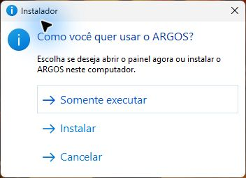
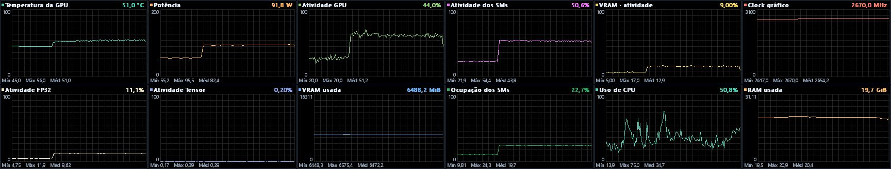

# ARGOS

Monitor de hardware em desenvolvimento para Windows 11, escrito em Rust. O ARGOS oferece uma janela com gráficos e modos de diagnóstico e coleta contínua no console. A GPU de referência é a NVIDIA GeForce RTX 5060 Ti de 16 GB.

As etapas do projeto e os critérios para avançar estão no [roadmap](ROADMAP.md).

## Distribuição para Windows

Abra `ARGOS-Setup.exe` no Windows 11 x64 e escolha uma opção.

- **Somente executar** abre o painel a partir de uma pasta temporária. Se o painel estiver fechado e houver uma instalação, você pode escolher entre a versão instalada e a versão do pacote, inclusive quando o pacote for mais antigo. Os arquivos extraídos são removidos ao fechar o painel.
- **Instalar** adiciona o ARGOS à conta atual e cria um atalho no menu Iniciar. Em CPUs compatíveis, o instalador prepara a leitura de temperatura com uma confirmação de administrador do Windows. Para desinstalar, abra **Configurações → Aplicativos → Aplicativos instalados**.

O painel mantém uma janela por conta do Windows. Se já houver uma janela aberta, pedir para executar uma versão igual ou mais antiga mostra o painel atual. Uma versão mais nova oferece a opção de trocar após fechar o painel. Ao instalar com o painel aberto, o instalador pede para fechá-lo e bloqueia a substituição de uma instalação por uma versão mais antiga. As duas opções usam as preferências do mesmo perfil do Windows.



## Compilar e executar

Use o Rust estável com o alvo `x86_64-pc-windows-msvc` e as ferramentas de compilação C++ da Microsoft. O executável incorpora o runtime C e, para as leituras de GPU, carrega a NVML fornecida pelo driver NVIDIA. A janela usa Win32 e GDI por meio das declarações da biblioteca `windows-sys`. Em execução, ela usa as bibliotecas do Windows. [Rust for Windows](https://github.com/microsoft/windows-rs)

```powershell
cargo build --release --locked
.\target\release\argos.exe gui
.\target\release\argos.exe
.\target\release\argos.exe --gpu 0 --samples 5 --interval-ms 1000
```

O comando padrão consulta todas as GPUs NVIDIA enumeradas pela NVML. Cada GPU recebe uma leitura dos sensores básicos e uma tentativa de leitura dos contadores GPM, com 1 s entre as coletas. `--samples` aumenta o número de intervalos GPM por GPU. `--interval-ms` aceita a partir de 101 ms, pois a NVIDIA exige mais de 100 ms entre amostras. [Funções GPM da NVML](https://docs.nvidia.com/deploy/nvml-api/latest/api/group__nvmlGpmFunctions.html)

### Gerar o instalador

Instale o Inno Setup 6.7 ou mais recente e execute o comando abaixo na raiz do projeto. Se `ISCC.exe` estiver no PATH, omita `-InnoCompiler`. [Inno Setup](https://jrsoftware.org/isdl.php)

```powershell
.\packaging\build.ps1 -InnoCompiler 'C:\Program Files (x86)\Inno Setup 6\ISCC.exe'
```

O pacote gerado fica em `target\dist\ARGOS-Setup.exe`.

### Atualizações pelo painel

O ARGOS verifica novas versões estáveis em segundo plano ao abrir. No menu do painel, use **Verificar nova versão do ARGOS** para consultar novamente. Quando o pacote estiver pronto, escolha **Atualizar e reiniciar** ou **Atualizar ao fechar**. O painel mostra as novidades na primeira abertura depois da atualização. A instalação usa o mesmo pacote em modo silencioso. No modo **Somente executar**, a versão verificada fica no perfil do Windows e é reutilizada nas próximas aberturas pelo lançador. Se também houver uma cópia instalada, **Escolher outra versão** oferece a cópia instalada e a versão do pacote aberto.

## Janela de monitoramento



Abra o painel pelo instalador, pelo menu Iniciar ou pelo comando `gui`. Na primeira abertura, o guia rápido mostra os principais controles e o painel usa um monitor secundário, quando disponível. Clique com o botão direito em qualquer área para abrir as opções de configuração e os comandos da janela. `gui --gpu ÍNDICE` seleciona outra GPU NVIDIA pelo índice da NVML.

Para mudar a posição da janela, selecione **Mover janela**, clique no painel e arraste com o botão esquerdo pressionado. Pressione `Esc` para cancelar. Arraste uma borda ou um canto para redimensionar. Ao reabrir, o painel restaura a última posição.

- **Taxa de amostragem** escolhe 100, 200, 500 ou 1.000 ms. A troca preserva o histórico. Quando a opção é 100 ms, o coletor GPM respeita seu mínimo de 101 ms. [Funções GPM da NVML](https://docs.nvidia.com/deploy/nvml-api/latest/api/group__nvmlGpmFunctions.html)
- **Grade** (`F4`) ajusta de 1 a 6 colunas e de 1 a 4 linhas visíveis. Na primeira abertura, o ARGOS mostra quatro gráficos numa linha, na ordem de uso da CPU, temperatura da CPU, RAM usada e FPS. Novos sensores ocupam os espaços livres. Use a roda do mouse ou a barra de rolagem à direita para ver os gráficos que ficam abaixo.
- **Sensores** (`F2`) escolhe as curvas visíveis. Clique com o botão direito num gráfico e use **Mesclar com** para sobrepor curvas da mesma unidade. O menu lista as curvas do painel e oferece **Separar gráficos** para devolver cada uma ao seu próprio painel.
- **FPS** segue o aplicativo em foco por padrão e mostra o estado da captura. Você pode escolher um executável específico ou usar **Desativado** para encerrar a captura. Na seção **Gráficos exibidos**, marque separadamente o FPS, o frametime e a espera da CPU.
- **Histórico** (`F3`) alterna entre 30 segundos, 1 minuto, 2 minutos e 5 minutos.
- Arraste um gráfico para posicioná-lo em um espaço livre ou para trocar de lugar com outro. O menu **Mover painel para** também permite escolher uma posição em outra página.
- Ao clicar em um gráfico, o menu também permite escolher ou restaurar a cor de cada curva, inclusive em gráficos mesclados.

O menu permanece aberto ao ajustar as configurações. Clique fora dele ou pressione `Esc` para fechá-lo.

O traçado ocupa a maior parte do painel, com fundo preto, quadriculado fino e unidade ao lado do valor atual. A escala vertical fica fixa durante a sessão. Percentuais e temperatura vão de 0 a 100. Memória usa a capacidade detectada, e potência e clocks usam limites informados pelo driver quando disponíveis. Uma leitura atual fora da escala mantém seu valor e recebe uma seta. [Consultas de dispositivos da NVML](https://docs.nvidia.com/deploy/nvml-api/latest/api/group__nvmlDeviceQueries.html)

Mínimo, máximo e média simples usam as leituras válidas do período selecionado. Leituras ausentes aparecem como lacunas, e a janela indica quando a coleta está atrasada. A coleta segue em segundo plano enquanto a janela está minimizada.

O ARGOS salva a posição e o tamanho da janela, a grade, as posições dos gráficos, os sensores, as mesclagens, as cores, a frequência e o período em `%LOCALAPPDATA%\ARGOS\dashboard.cfg`.

### FPS

O ARGOS começa no modo **Aplicativo em foco**. Enquanto você interage com o painel, o ARGOS mantém o último aplicativo acompanhado. O menu **FPS** permite escolher outro modo de captura para a sessão atual. A escolha do aplicativo e a visibilidade dos gráficos são independentes. A captura usa eventos do Windows para chamadas `Present()` do DXGI e do Direct3D 9. O Windows exige execução como administrador ou uma conta no grupo **Performance Log Users** para essa sessão. O menu mostra quando a captura está indisponível. [Permissões do ETW](https://learn.microsoft.com/en-us/windows/win32/api/evntrace/nf-evntrace-starttracew#return-value)

| Sensor | Medição |
| --- | --- |
| FPS apresentado | Taxa calculada a partir dos intervalos entre apresentações bem-sucedidas na cadeia de apresentação mais ativa do processo. |
| Frametime (pico) | Maior intervalo entre inícios de chamadas `Present()` na janela de amostragem mais recente. |
| Espera CPU (pico) | Maior tempo que a thread passou dentro de `Present()` na janela de amostragem mais recente. |

O FPS usa uma janela de até 1 s. O frametime e a espera da CPU usam o intervalo definido em **Taxa de amostragem**. As medições se referem a apresentações do aplicativo. Quadros efetivamente exibidos, quadros gerados pelo driver e espera da GPU exigem outras fontes de eventos. O Windows pode entregar eventos em lotes, mesmo com o painel configurado para atualizar a cada 100 ms. Os tempos são calculados a partir dos relógios dos próprios eventos. [Entrega de buffers do ETW](https://learn.microsoft.com/en-us/windows/win32/api/evntrace/ns-evntrace-event_trace_properties) · [Cálculo da espera no PresentMon](https://github.com/GameTechDev/PresentMon/blob/main/IntelPresentMon/CommonUtilities/mc/MetricsCalculatorCpuGpu.cpp#L35-L49)

### Temperatura da CPU

O painel consulta o sensor de controle (`Tctl`) de AMD Zen das famílias `17h`, `19h` e `1Ah` ou o sensor digital do pacote de CPUs Intel que oferecem essa leitura. A coleta acompanha o intervalo configurado no painel enquanto o gráfico está selecionado.

O `ARGOS-Setup.exe` provisiona o driver assinado PawnIO e o serviço local **ARGOS Sensor de CPU** na primeira instalação ou atualização compatível. O painel usa as permissões normais da conta e o serviço inicia sob demanda. **Somente executar** aproveita um serviço já instalado. Se a leitura estiver indisponível, o gráfico mostra **N/D** e o menu **Sensores** informa o motivo. [Driver PawnIO](https://pawnio.eu/) · [Módulos oficiais](https://github.com/namazso/PawnIO.Modules/releases/tag/0.2.11)

Em **Aplicativos instalados**, **ARGOS Sensor de CPU** remove o serviço compartilhado pelas cópias do ARGOS nesta máquina. O PawnIO tem sua própria entrada, pois pode ser usado por outros programas.

## Coleta contínua

```powershell
.\target\release\argos.exe watch
.\target\release\argos.exe watch --gpu 0 --gpu-interval-ms 500 --gpm-interval-ms 1000 --system-interval-ms 2000 --duration-secs 20
```

`watch` lê os sensores básicos de uma GPU NVIDIA, os contadores GPM e o uso de CPU e RAM. Cada grupo usa inicialmente um intervalo mínimo de 1 s e tem seu próprio ajuste. A GPU de índice 0 é a padrão. Quando ela está indisponível, o monitor mantém a leitura de CPU e RAM. Ao informar `--gpu`, um índice inválido é tratado como erro.

A primeira leitura de CPU e dos contadores GPM aguarda duas amostras. Falhas temporárias e métricas indisponíveis deixam lacunas no histórico. O horário exibido é o tempo decorrido desde o início da coleta. Para GPM, a saída também indica o intervalo observado entre amostras. O uso de CPU é calculado com os tempos ocupado e ocioso do Windows. Em máquinas com múltiplos grupos de processadores, essa leitura fica indisponível, pois a API consultada cobre apenas o grupo primário. [Tempos de CPU do Windows](https://learn.microsoft.com/en-us/windows/win32/api/processthreadsapi/nf-processthreadsapi-getsystemtimes)

O histórico retém até 5 minutos por grupo em memória. O console recebe as atualizações de forma independente da coleta, com uma fila limitada. Pressione `Ctrl+C` ou use `--duration-secs` para encerrar e ver o resumo. Use `watch --help` para consultar os intervalos aceitos.

Na sessão de validação de 30 min e 5 s, com intervalo de 1 s por grupo e saída redirecionada, cada grupo reteve 298 de 300 amostras possíveis na janela final. O processo usou em média 0,082% de um processador lógico e chegou a 31,35 MiB nas medições de memória residente. Esse teste serve de referência para o modo console. O impacto nos tempos de quadro será medido separadamente.

## Como interpretar as leituras

- O inventário usa as APIs do Windows para identificar o sistema, a CPU, os processadores lógicos ativos e a RAM utilizável.
- A NVML fornece o modelo da GPU, as versões do driver e da biblioteca, o modo do driver, a VRAM, a atividade da GPU e da VRAM, a temperatura, a potência, os clocks e a atividade de NVENC e NVDEC. Cada API tem sua própria janela de medição. Por exemplo, o driver retorna a potência média de 1 s na GPU de referência. [Consultas de dispositivos da NVML](https://docs.nvidia.com/deploy/nvml-api/latest/api/group__nvmlDeviceQueries.html)
- A consulta de suporte GPM é feita por GPU. Quando há suporte, duas amostras alimentam o cálculo dos cinco contadores percentuais abaixo. Uma leitura válida de `0%` é exibida como valor. A sonda de diagnóstico mostra o motivo disponível quando a consulta, a coleta ou um contador individual falha. [Definições dos contadores GPM](https://docs.nvidia.com/deploy/nvml-api/latest/api/group__nvmlGpmEnums.html)

| ID GPM | Métrica | O que o driver mede |
| --- | --- | --- |
| 2 | Atividade dos SMs | Percentual de SMs ocupados |
| 3 | Ocupação dos SMs | Warps ativos em relação ao máximo teórico |
| 5 | Atividade Tensor | Fração do tempo em que os SMs executaram operações Tensor |
| 10 | VRAM · largura de banda | Fração da largura de banda teórica da VRAM utilizada |
| 12 | Atividade FP32 | Fração do tempo em que os SMs executaram operações FP32 fora das unidades Tensor |

## Validação inicial

Na RTX 5060 Ti de 16 GB, com Windows 11 build 26320 e driver NVIDIA 621.14 em modo WDDM, a NVML informou suporte a GPM e reportou 16.311 MiB de VRAM. O executável compilado em modo release, rodando sem elevação, obteve os cinco contadores tanto na janela padrão de 1 s quanto em cinco janelas consecutivas configuradas para 101 ms.

Na janela de 1 s, o driver reportou 11,81% de atividade FP32, 0,31% de atividade Tensor, 62,89% de atividade dos SMs, 29,25% de ocupação dos SMs e 22,65% da largura de banda teórica da DRAM. A execução usou a atividade normal da máquina, sem carga controlada. A precisão sob cargas conhecidas e o impacto nos frametimes ainda precisam ser medidos.

## Reproduzir o diagnóstico

1. Rode a sonda com `--samples 5 --interval-ms 1000` e registre o modelo da GPU, o driver, o modo e os estados dos contadores em repouso.
2. Repita durante uma carga conhecida. Para validar a resposta dos contadores, mantenha a carga estável por vários intervalos e use cargas que exercitem operações FP32 e Tensor em execuções separadas.
3. Se quiser comparar com a ferramenta da NVIDIA, faça uma execução separada com `nvidia-smi dmon -i 0 -c 5 -d 1 --gpm-metrics 2,3,5,10,12 --gpm-options d`, nos drivers que aceitam essa opção. O `nvidia-smi` é opcional para a comparação. [Referência do NVIDIA System Management Interface](https://docs.nvidia.com/deploy/nvidia-smi/index.html)

RT Cores, cache L2 e os tempos de GPU por quadro seguem em investigação. A captura de apresentações ainda precisa ser validada durante um jogo e medida quanto ao impacto nos tempos de quadro.

## Licença

O código do ARGOS é distribuído sob a licença MIT. Os módulos PawnIO seguem a licença LGPL 2.1 ou posterior. Os avisos e fontes correspondentes acompanham o pacote. [Licença do ARGOS](LICENSE) · [Avisos do PawnIO](packaging/pawnio/NOTICE.txt)
