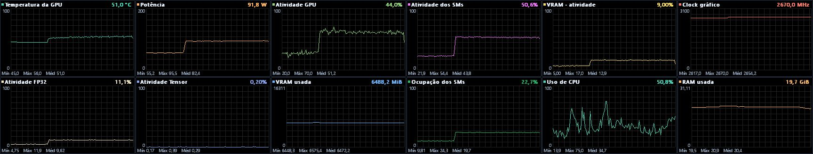
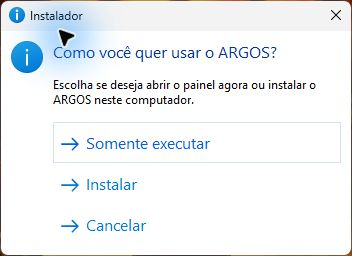

<p align="center">
  
</p>

<h1 align="center">ARGOS</h1>

<p align="center"><strong>Monitor de hardware em tempo real para Windows</strong></p>

<p align="center">
  Acompanhe CPU, GPU, memória, FPS, rede e armazenamento em uma janela personalizável, pensada para o segundo monitor.
</p>

<p align="center">
  <a href="https://github.com/MrDoom11/ARGOS/releases/latest/download/ARGOS-Setup.exe"><strong>Baixar ARGOS para Windows x64</strong></a>
  · <a href="https://github.com/MrDoom11/ARGOS/releases">Notas das versões</a>
</p>

<p align="center">
  <a href="#instalação">Instalação</a> · <a href="#guia-do-painel">Guia do painel</a> · <a href="#métricas-e-permissões">Métricas</a> · <a href="#compilar-do-código-fonte">Compilação</a> · <a href="#diagnóstico-no-console">Diagnóstico</a> · <a href="ROADMAP.md">Roadmap</a>
</p>



## O que o ARGOS monitora

O ARGOS é um aplicativo nativo escrito em Rust. Ele obtém as leituras diretamente das APIs do Windows e dos drivers de vídeo e mantém o histórico em memória no próprio computador.

| Grupo | Leituras disponíveis |
| --- | --- |
| **Processador** | Uso total, temperatura e potência média do pacote em CPUs compatíveis. |
| **Memória** | RAM usada e disponível. |
| **Placa de vídeo** | Uso, temperatura, potência da placa, clocks, VRAM e atividade dos motores de vídeo conforme o modelo e o driver. É possível acompanhar placas NVIDIA e Radeon ao mesmo tempo, com histórico por GPU. |
| **Contadores NVIDIA GPM** | Atividade dos SMs, ocupação de warps, atividade Tensor e FP32 e uso da largura de banda da VRAM nas GPUs que expõem esses contadores. |
| **Quadros** | FPS do aplicativo, pico do intervalo entre quadros e pico do tempo dentro de `Present()`. |
| **Rede** | Download e upload do adaptador físico escolhido, latência do aplicativo monitorado e ping personalizado para até quatro destinos. |
| **Armazenamento** | Taxas de leitura e escrita, atividade de E/S e espaço ocupado por volume local. |

## Instalação

| Sistema | Compatibilidade |
| --- | --- |
| **Windows 11 x64** | Sistema recomendado e alvo das otimizações do ARGOS. |
| **Windows 10 22H2 x64** | O instalador aceita a build 19045 a partir do ARGOS 0.4.1. O aplicativo pode apresentar problemas de funcionamento nesse sistema. |

O suporte regular da Microsoft ao Windows 10 22H2 terminou em **14 de outubro de 2025**. [Ciclo de vida do Windows 10](https://learn.microsoft.com/pt-br/lifecycle/announcements/windows-10-end-of-support)

Baixe e abra `ARGOS-Setup.exe`. A tela inicial oferece duas opções. [Última versão estável](https://github.com/MrDoom11/ARGOS/releases/latest)

| Opção | Como funciona |
| --- | --- |
| **Somente executar** | Abre o painel a partir de uma pasta temporária e limpa os arquivos extraídos ao fechar. Pode aproveitar o serviço de sensores da CPU se ele já estiver instalado. |
| **Instalar** | Instala o ARGOS para a conta atual e cria um atalho no menu Iniciar. Em processadores compatíveis, o instalador solicita permissão de administrador para preparar o componente de temperatura e potência da CPU. |

<details>
<summary>Ver a tela inicial do instalador</summary>



</details>

Para abrir o painel ao entrar na conta do Windows, use **Painel → Iniciar com o Windows** na versão instalada. Para desinstalar o ARGOS, procure por ele na lista de aplicativos instalados do Windows.

### Atualizações

O ARGOS consulta novas versões estáveis ao abrir. Para consultar manualmente, clique com o botão direito no painel e selecione **Buscar por atualizações**. Assim que o download estiver verificado, abra **Atualizações** e escolha **Atualizar e reiniciar** ou **Atualizar ao fechar**. O agendamento vale para a sessão atual. As novidades aparecem na primeira abertura após a atualização.

<details>
<summary>Verificação de atualizações e escolha da versão</summary>

O atualizador confere a assinatura Ed25519 do manifesto e o SHA-256 do instalador baixado.

O painel mantém uma janela por conta do Windows. Uma versão igual ou mais antiga traz o painel aberto para frente. Uma versão mais nova oferece a troca após fechá-lo. O instalador pede para fechar o painel antes de substituir a versão instalada e bloqueia a instalação sobre uma versão mais nova.

Com o painel fechado, **Somente executar** pode oferecer a escolha entre a versão instalada e a versão do pacote. Os dois modos compartilham as preferências da conta. Atualizações verificadas no modo **Somente executar** ficam no perfil do Windows e podem ser reaproveitadas pelo lançador.

</details>

## Guia do painel

Na primeira abertura, o guia rápido apresenta os controles. Se houver um segundo monitor, o ARGOS abre nele por padrão. A grade inicial mostra **uso da CPU**, **temperatura da CPU**, **RAM usada** e **FPS**. Abra o menu com o **botão direito** para ajustar a exibição.

| Para fazer isto | Use |
| --- | --- |
| Escolher o que acompanhar | **Sensores** (`F2`). Para selecionar mais de uma placa, abra **GPU → GPUs monitoradas**. O modo automático usa uma GPU e dá preferência à NVIDIA. |
| Mudar o período visível | **Painel → Histórico** (`F3`). Escolha 30 s, 1 min, 2 min ou 5 min. |
| Redimensionar a grade | **Painel → Grade** (`F4`). A grade tem de 1 a 6 colunas e de 1 a 4 linhas visíveis. Use a rolagem para ver os gráficos abaixo. |
| Mover ou redimensionar a janela | Selecione **Mover janela** e arraste o painel. Arraste as bordas para redimensionar. No modo normal, é possível encaixar a janela usando o gesto configurado no **FancyZones** do PowerToys. |
| Reorganizar ou mesclar gráficos | Arraste para reorganizar. Com opacidade em 100%, clique com o botão direito sobre um gráfico para abrir **Gráfico** e mover, mesclar curvas da mesma unidade ou separá-las. |
| Ajustar tema, opacidade e cores | **Painel → Aparência** reúne os temas claro e escuro, a opacidade de 0% a 100% e **Cor dos gráficos**. Com opacidade abaixo de 100%, use a faixa superior de 10 pixels para abrir o menu. A barra de rolagem continua interativa e os demais cliques passam para o aplicativo de baixo. |
| Alterar a cadência de leitura | **Painel → Intervalo de amostragem**. As opções são 100, 200, 500 e 1.000 ms. Alterar a cadência preserva o histórico. Cada fonte respeita seu próprio ritmo e o GPM usa pelo menos 101 ms. |

A coleta continua enquanto a janela estiver minimizada. Para mostrar o painel outra vez, clique no ícone do ARGOS perto do relógio. As preferências de gráficos, aparência e posição da janela ficam em `%LOCALAPPDATA%\ARGOS\dashboard-multi.cfg`. Layouts da versão 0.2.x podem ser reaproveitados na primeira abertura.

### Modo dropdown

Em **Painel → Modo dropdown**, escolha um monitor e ative o modo. O painel fica recolhido no topo e abre quando você mantém o cursor na faixa de ativação. Use **Mostrar faixa de ativação** para encontrá-la, ajuste a posição e a largura ou configure um atalho global. **Fixar aberto** mantém o painel visível. Os gráficos e a coleta continuam ativos enquanto ele estiver recolhido.

## Métricas e permissões

Os gráficos mostram o valor atual e o mínimo, máximo e média das amostras válidas no período escolhido. Leituras ausentes deixam lacunas. **N/D** indica indisponibilidade e um **0** registrado representa uma leitura válida.

### Temperatura e potência da CPU

Em **Sensores → CPU**, a temperatura vem do sensor de controle `Tctl` em AMD Zen das famílias `17h`, `19h` e `1Ah`, ou do sensor digital do pacote em CPUs Intel compatíveis. A potência em watts é a média do pacote entre duas leituras do contador de energia. Em **Sensores → Memória**, a RAM disponível inclui memória em espera que o Windows pode reutilizar. [Intel RAPL](https://www.intel.com/content/www/us/en/developer/articles/technical/software-security-guidance/advisory-guidance/running-average-power-limit-energy-reporting.html) · [Memória física no Windows](https://learn.microsoft.com/pt-br/windows/win32/api/sysinfoapi/ns-sysinfoapi-memorystatusex)

Para temperatura e potência, o instalador provisiona o driver assinado **PawnIO** e o serviço local **ARGOS Sensor de CPU** em hardware compatível. O serviço inicia sob demanda e o painel pode consultá-lo com as permissões normais da conta. Se um sensor ficar indisponível, veja o motivo em **Sensores → CPU**. Na lista de aplicativos do Windows, **ARGOS Sensor de CPU** e **PawnIO** têm entradas próprias. O driver pode ser usado por outros programas. [Driver PawnIO](https://pawnio.eu/)

### FPS e tempos de quadro

Abra **Sensores → FPS → Aplicativo monitorado** para seguir o aplicativo em foco, selecionar um processo ou desativar a captura. A escolha do processo e a visibilidade dos gráficos são independentes. O ARGOS preserva o último aplicativo acompanhado enquanto você interage com o painel. O **Teto do gráfico** ajusta a escala, que começa em 360 FPS.

A captura usa ETW para acompanhar chamadas `Present()` do DXGI e do Direct3D 9. A sessão requer privilégios de administrador ou uma conta no grupo **Performance Log Users**. Se o painel pedir elevação, use **Painel → Sempre abrir como administrador** para solicitar a confirmação do Windows a cada sessão. [Permissões do ETW](https://learn.microsoft.com/en-us/windows/win32/api/evntrace/nf-evntrace-starttracew#return-value)

| Gráfico | O que mede |
| --- | --- |
| **FPS do aplicativo** | Taxa das apresentações bem-sucedidas na cadeia de apresentação mais ativa do processo, numa janela de até 1 s. |
| **Intervalo entre quadros (pico)** | Maior intervalo entre os inícios de duas chamadas `Present()` na janela de amostragem mais recente. |
| **Tempo em Present() (pico)** | Maior tempo que a thread passou dentro da chamada `Present()` na janela de amostragem mais recente. |

Essas leituras descrevem as apresentações feitas pelo aplicativo. A contagem de quadros efetivamente exibidos, a geração de quadros pelo driver e o tempo de GPU por quadro exigem outras fontes de eventos.

<details>
<summary>Detalhes dos sensores de GPU, rede e armazenamento</summary>

- **NVIDIA e AMD Radeon.** O ARGOS usa NVML e ADLX dos respectivos drivers. Em Radeon, o painel mostra **RAM compartilhada da GPU** em um gráfico próprio e usa os contadores do Windows para os motores de vídeo, inclusive quando codificação e decodificação compartilham um motor. O Windows pode expor esses contadores apenas depois que um aplicativo começar a usá-los. [NVIDIA NVML](https://docs.nvidia.com/deploy/nvml-api/latest/api/group__nvmlDeviceQueries.html) · [AMD ADLX](https://gpuopen.com/manuals/adlx/adlx-sdk-references/adlx-interfaces/performance-monitoring/iadlxgpumetrics/) · [Motores de GPU no Windows](https://learn.microsoft.com/en-us/windows-hardware/drivers/ddi/d3dkmdt/ne-d3dkmdt-dxgk_engine_type)
- **Ping do aplicativo.** Em **Sensores → Rede → Ping**, o ARGOS acompanha o aplicativo definido no menu de FPS ou segue o aplicativo em foco. A descoberta do destino por ETW pode exigir privilégios de administrador. A amostragem é de 1 s e usa o RTT fornecido pelo Windows para TCP ou uma sonda ICMP para o IP observado no tráfego UDP. O IP mostrado pode ser de um jogador, relay ou servidor. O menu **Rede** mostra o destino, o método e o motivo de indisponibilidade. [RTT do TCP no Windows](https://learn.microsoft.com/en-us/windows/win32/api/tcpestats/ns-tcpestats-tcp_estats_path_rod_v0) · [Sondagem ICMP](https://learn.microsoft.com/en-us/windows/win32/api/icmpapi/)
- **Ping personalizado.** Em **Sensores → Rede → Ping personalizado → Editar endereços…**, adicione até quatro destinos IPv4, IPv6 ou nomes de host, um por linha. O gráfico mostra uma curva por destino e consulta cada um por ICMP a cada segundo enquanto estiver ativo. Destinos sem resposta deixam lacunas.
- **Download e upload.** Selecione o adaptador físico em **Sensores → Rede → Interface de rede**. As taxas em Mbps incluem todo o tráfego da interface, inclusive o da rede local. A escala usa a velocidade do link, quando informada pelo Windows, ou o maior valor do histórico. Trocar de interface reinicia o histórico dessas taxas. [Contadores de interface](https://learn.microsoft.com/en-us/windows/win32/api/netioapi/ns-netioapi-mib_if_row2)
- **Armazenamento.** Em **Sensores → Armazenamento**, selecione os volumes locais, como `C:` e `D:`. Leitura e escrita usam MiB/s. Atividade indica a fração do tempo em operações de E/S. Espaço ocupado indica a fração da capacidade em uso. [Contadores de E/S](https://learn.microsoft.com/en-us/windows-hardware/drivers/ddi/ntdddisk/ns-ntdddisk-_disk_performance) · [Capacidade do volume](https://learn.microsoft.com/en-us/windows/win32/api/fileapi/nf-fileapi-getdiskspaceinformationw)

</details>

## Compilar do código-fonte

Use o **Rust estável** com o alvo `x86_64-pc-windows-msvc`, as ferramentas de compilação C++ da Microsoft e o SDK do Windows. Na raiz do repositório, execute os comandos abaixo em PowerShell. [Instalar Rust](https://www.rust-lang.org/tools/install) · [Visual Studio Build Tools](https://visualstudio.microsoft.com/downloads/#build-tools-for-visual-studio)

```powershell
rustup target add x86_64-pc-windows-msvc
cargo build --release --locked --target x86_64-pc-windows-msvc

$argos = '.\target\x86_64-pc-windows-msvc\release\argos.exe'
& $argos gui
```

A interface usa Win32 e GDI via `windows-sys`. A compilação para MSVC incorpora o runtime C e a telemetria de GPU carrega as bibliotecas fornecidas pelos drivers. [Rust for Windows](https://github.com/microsoft/windows-rs)

### Gerar o instalador

Use o Inno Setup 6.7 ou mais recente. Se `ISCC.exe` estiver no `PATH`, execute `.\packaging\build.ps1` sem parâmetros. Caso contrário, informe o caminho do compilador. [Inno Setup](https://jrsoftware.org/inno-setup/downloads)

```powershell
.\packaging\build.ps1 -InnoCompiler 'C:\Program Files (x86)\Inno Setup 6\ISCC.exe'
```

O instalador gerado fica em `target\dist\ARGOS-Setup.exe`.

## Diagnóstico no console

Com a variável `$argos` definida como no exemplo de [compilação](#compilar-do-código-fonte), execute a sonda no mesmo terminal. Sem argumentos, o executável lista o inventário do sistema e consulta todas as GPUs NVIDIA e Radeon encontradas. Use `--gpu 0` ou `--gpu nvidia:0` para selecionar a primeira NVIDIA e `--gpu amd:0` para selecionar a primeira Radeon. Os mesmos índices funcionam com `gui` e `watch`.

```powershell
& $argos
& $argos --gpu 0 --samples 5 --interval-ms 1000
& $argos --help
```

### Contadores NVIDIA GPM

Em GPUs compatíveis, a sonda lê cinco contadores a partir de duas amostras. O intervalo padrão é de 1 s e o mínimo é de 101 ms. Se uma leitura falhar, o console informa o motivo disponível. [Contadores GPM](https://docs.nvidia.com/deploy/nvml-api/latest/api/group__nvmlGpmEnums.html) · [Amostragem GPM](https://docs.nvidia.com/deploy/nvml-api/latest/api/group__nvmlGpmFunctions.html)

| ID | Contador | Significado |
| --- | --- | --- |
| 2 | SMs ativos | Percentual de SMs ocupados. |
| 3 | Ocupação de warps | Warps ativos em relação ao máximo teórico dos SMs. |
| 5 | Atividade Tensor | Fração do tempo em que os SMs executaram operações Tensor. |
| 10 | Uso da banda da VRAM | Fração da largura de banda teórica da VRAM utilizada. |
| 12 | Atividade FP32 | Fração do tempo em que os SMs executaram operações FP32 fora das unidades Tensor. |

Para avaliar a resposta dos contadores, compare as leituras em repouso e sob cargas estáveis de FP32 e Tensor, em execuções separadas. Em drivers que oferecem GPM no `nvidia-smi`, use `nvidia-smi dmon -i 0 -c 5 -d 1 --gpm-metrics 2,3,5,10,12 --gpm-options d` para uma comparação com a ferramenta da NVIDIA. [NVIDIA System Management Interface](https://docs.nvidia.com/deploy/nvidia-smi/index.html)

## Coleta contínua

```powershell
& $argos watch
& $argos watch --gpu 0 --gpu-interval-ms 500 --duration-secs 20
& $argos watch --help
```

O modo `watch` acompanha CPU, RAM e sensores de GPU no terminal. Cada grupo começa em 1 s e pode ter seu próprio intervalo. Para acompanhar várias GPUs, repita `--gpu`, por exemplo `watch --gpu 0 --gpu amd:0`. O histórico retém até 5 minutos por grupo. A saída usa o tempo decorrido desde o início da coleta. Pressione `Ctrl+C` ou use `--duration-secs` para encerrar e ver o resumo.

<details>
<summary>Resultados da validação inicial</summary>

- **Coleta contínua.** Em uma sessão de **30 min e 5 s** com cadência de 1 s por grupo e saída redirecionada, cada grupo reteve 298 das 300 amostras possíveis na janela final. O processo usou em média **0,082% de um processador lógico** e chegou a **31,35 MiB de memória residente**. Os valores se referem a essa execução do modo console.
- **Contadores GPM.** A RTX 5060 Ti de 16 GB retornou os cinco contadores com Windows 11 build 26320 e driver NVIDIA 621.14 em modo WDDM. O teste rodou com conta padrão e registrou a atividade normal da máquina em janelas de 1 s e 101 ms.

</details>

## Roadmap e contribuições

O ARGOS está em desenvolvimento. A validação da precisão sob cargas controladas e a medição do impacto do painel nos tempos de quadro de jogos seguem no planejamento. Contadores de RT Cores, cache L2 e tempo de GPU por quadro estão em investigação. [Roadmap do ARGOS](ROADMAP.md)

Para relatar um problema, inclua a versão do ARGOS, a versão e a build do Windows, o hardware e o driver envolvidos, o sensor afetado e os passos para reproduzir. Para sugerir um recurso, descreva como você o usaria. [Issues do ARGOS](https://github.com/MrDoom11/ARGOS/issues)

## Licença

O código do ARGOS é distribuído sob a licença **MIT**. Os módulos PawnIO incluídos no instalador seguem a **LGPL 2.1 ou posterior**, com avisos e fontes correspondentes no pacote. [Licença do ARGOS](LICENSE) · [Avisos do PawnIO](packaging/pawnio/NOTICE.txt)
